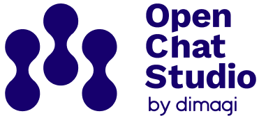

# Open Chat Studio Documentation

[](https://github.com/dimagi/open-chat-studio)

This repository contains the **user documentation** for [Open Chat Studio](https://github.com/dimagi/open-chat-studio) (OCS), published at [docs.openchatstudio.com](https://docs.openchatstudio.com/).

OCS is a platform for building, deploying, and evaluating AI-powered chat applications. It provides tools for working with various LLMs (Large Language Models), creating chatbots, managing conversations, and integrating with different messaging platforms.

## How the docs stay up to date

Most pages in this repo are written by automation, not by hand. OCS uses a **Docs-as-Code + LLM Augmentation approach**: the docs are markdown in git and go through pull requests like code. When a code PR merges in the [OCS repo](https://github.com/dimagi/open-chat-studio), a workflow here has Claude draft a changelog entry and any needed docs updates, and opens a PR assigned to the code PR's author for review. Each week, another workflow drafts a [GitHub release](https://github.com/dimagi/open-chat-studio-docs/releases) from the new changelog entries for a person to review and publish.

The reasoning and the developer's part of the process are in the [user documentation and changelog process](https://developers.openchatstudio.com/developer_guides/user_docs/) guide. See also [changelog automation](https://developers.openchatstudio.com/developer_guides/user_docs/changelog_automation/) and [weekly release notes](https://developers.openchatstudio.com/developer_guides/user_docs/release_notes/).

## Where to start

### Contributing documentation by hand

Manual edits are for changes the automation does not cover: corrections, restructuring, new tutorials or concepts, and changes when the automation did not fire or cannot run (for example, on a fork).

- Read [Contributing to user docs](https://developers.openchatstudio.com/contributing/user_docs/) for page types, writing guidance, and how to rename pages safely.
- Read [AGENTS.md](AGENTS.md) for the page type conventions, writing style, commands and branch workflow. [Chat widget docs](https://docs.openchatstudio.com/chat_widget/) go to `widget-develop`, everything else to `main`.
- Use the [Zensical documentation](https://zensical.org/docs/authoring/markdown/) for markdown features.
- If the automation missed an OCS PR, re-run it from GitHub Actions. Steps are in the [changelog automation guide](https://developers.openchatstudio.com/developer_guides/user_docs/changelog_automation/).
- Don't edit `docs/api/`. It is generated from the OCS OpenAPI schema (see the [REST API docs](https://www.openchatstudio.com/api/docs/)) by `src/ocs_docs/openapi_to_docs.py`, run by the `update-api-docs` workflow.
- Manual changelog edits are fine. Match the existing style in `docs/changelog.md`; the entry format is in [AGENTS.md](AGENTS.md#changelog).

### Improving the repo's processes, security, and tooling

Start with these, and follow their links from there:

- [AGENTS.md](AGENTS.md) for the architecture, commands, and tooling in this repo.
- [.github/workflows/AGENTS.md](.github/workflows/AGENTS.md) for the security rules for writing or changing a workflow.
- [README-changelog-automation.md](.github/workflows/README-changelog-automation.md) for the changelog and docs pipeline.
- [README-claude-workflows.md](.github/workflows/README-claude-workflows.md) for every Claude workflow, command, and agent.

Each workflow also documents its triggers, secrets, and caveats in its own header comment. Keep those comments current when you change a workflow.

## Quickstart

Assuming you've already cloned this repository:

1. Install [UV python package and project manager](https://docs.astral.sh/uv/getting-started/installation/)

    ```shell
    curl -LsSf https://astral.sh/uv/install.sh | sh
    ```

2. Set up the project

    ```shell
    uv venv
    uv sync --locked
    ```

3. Install the pre-commit hooks

    ```shell
    uv run prek install --install-hooks
    ```

4. Start the project

    ```shell
    uv run zensical serve
    ```

5. Before pushing, run the build to catch broken internal links (CI will fail if you don't)

    ```shell
    uv run zensical build --clean
    ```
