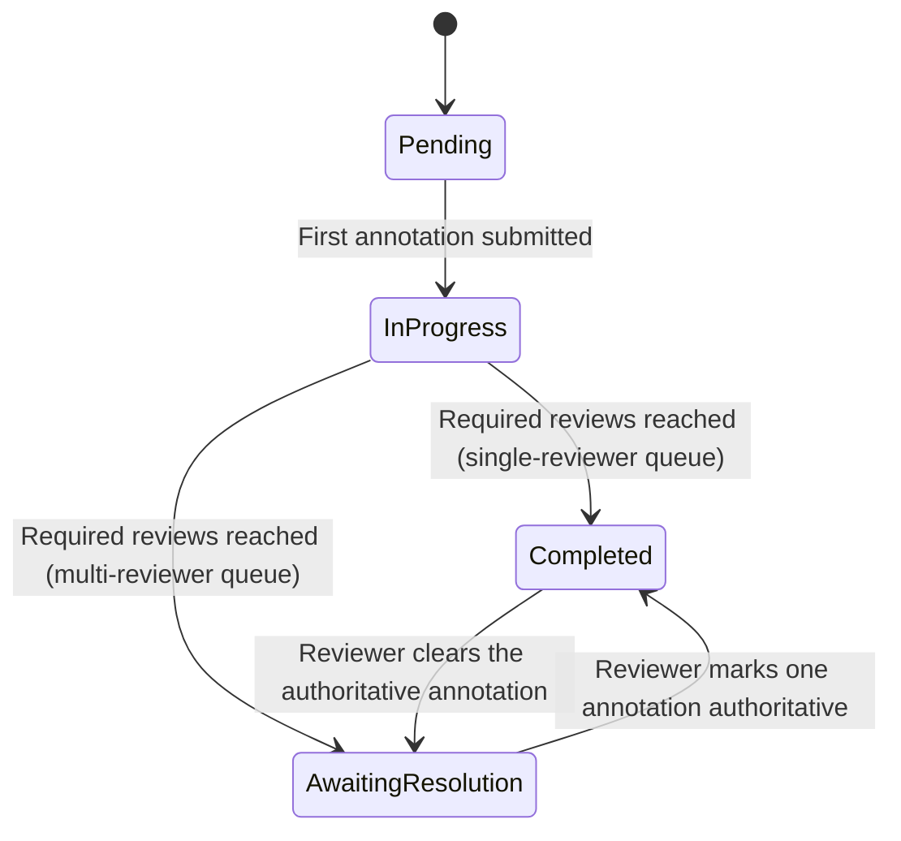

# Annotating

Reviewers work through a queue one session at a time.
Once you add a session to a queue, OCS calls it an **item**: the queue's **Items** table lists it, and its status shows its review progress.
Reviewers submit an annotation, edit it, skip the item or flag it.
This page explains how an item moves between statuses and how conflicting reviews are resolved.
For the steps a reviewer follows, see [Annotate Queue Items](../../how-to/annotations/annotate-items.md).

## Item Status Lifecycle

An item in any status can also be **Flagged**.
Unflagging returns it to the status its reviews give it, as shown in the diagram.
See [Flagging Items](#flagging-items).

| Status | Meaning |
|--------|---------|
| **Pending** | No annotations yet |
| **In Progress** | At least one annotation submitted, but not yet at the required count |
| **Awaiting resolution** | Multi-reviewer item has all required reviews, but no annotation has been marked **authoritative** yet |
| **Completed** | Required number of reviews have been submitted (and, for multi-reviewer queues, an authoritative annotation has been selected) |
| **Flagged** | Marked for follow-up; left out of the annotation sequence until unflagged |

!!! note "Single vs multi-reviewer queues"
    On single-reviewer queues (the default, **Num reviews required = 1**), the first submitted annotation is automatically marked as authoritative and the item moves straight to **Completed**. The authoritative workflow below only applies to queues configured with **Num reviews required > 1**.

## Resolving Multi-Reviewer Conflicts

When a multi-reviewer queue collects all required reviews for an item, the item enters **Awaiting resolution** until a reviewer picks one annotation as the authoritative answer.
Only one annotation per item can be authoritative, and choosing a different one replaces the earlier choice.
Clearing the choice returns the item to **Awaiting resolution**.

The item page shows a banner saying an admin must make the choice, but no admin permission is needed.
Any team member who can open the item can do it.
For the steps, see [Resolve an Item Awaiting Resolution](../../how-to/annotations/annotate-items.md#resolve-an-item-awaiting-resolution).

!!! tip "Effect on aggregate scores"
    Aggregate scores use the authoritative annotation when one is set.
    Only when no annotation is authoritative do they average across all submitted annotations.
    Marking an authoritative annotation therefore resolves the conflict and makes the queue's aggregate scores reflect the agreed answer.

## Flagging Items

Flagging marks an item that cannot be annotated, such as one with missing content or a corrupted session.
Each flag records the reviewer's name, the time and an optional reason.
Flagging an item again adds another entry rather than replacing the earlier one.

A **Flagged** item stays out of the annotation sequence until someone unflags it.
Its annotations stay in place and still count towards the queue's aggregate scores.
Flagged items are always included in [exports](../../how-to/annotations/export-annotations.md), with their flag entries.

Anyone with permission to change queue items can flag or unflag them.

For the steps, see [Flag an Item](../../how-to/annotations/annotate-items.md#flag-an-item) and [Unflag an Item](../../how-to/annotations/manage-a-queue.md#unflag-an-item).

## Read-Only View

Each reviewer can submit only one annotation per item.
When you open an item you've already annotated, you see the item content and the annotations list without the submission form.
To change your answers, see [Annotate or Edit a Single Item](../../how-to/annotations/annotate-items.md#annotate-or-edit-a-single-item).

If the queue has assignees and you are not one of them, you also see the annotations list instead of the form.
You can read the item and its annotations, but you can't submit one.
