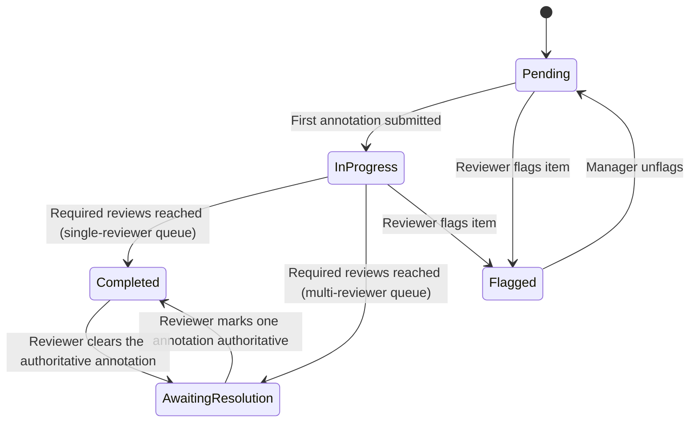

# Annotating

Reviewers work through a queue one item at a time.
They submit an annotation, edit it, skip the item or flag it.
This page explains how an item moves between statuses and how conflicting reviews are resolved.
For the steps a reviewer follows, see [Annotate Queue Items](../../how-to/annotations/annotate-items.md).

Flagging marks an item that cannot be annotated, such as one with missing content or a corrupted session.
The reviewer must give a reason, which is recorded with their name and the time.
Flagged items are excluded from the annotation sequence until a queue manager unflags them.

## Item Status Lifecycle

| Status | Meaning |
|--------|---------|
| **Pending** | No annotations yet |
| **In Progress** | At least one annotation submitted, but not yet at the required count |
| **Awaiting resolution** | Multi-reviewer item has all required reviews, but no annotation has been marked **authoritative** yet |
| **Completed** | Required number of reviews have been submitted (and, for multi-reviewer queues, an authoritative annotation has been selected) |
| **Flagged** | Marked for follow-up; excluded from annotation workflow |

!!! note "Single vs multi-reviewer queues"
    On single-reviewer queues (the default, **Reviews required = 1**), the first submitted annotation is automatically marked as authoritative and the item moves straight to **Completed**. The authoritative workflow below only applies to queues configured with **Reviews required > 1**.

## Resolving Multi-Reviewer Conflicts

When a multi-reviewer queue collects all required reviews for an item, the item enters **Awaiting resolution** until a reviewer picks one annotation as the authoritative answer.

On the annotate-item page, any annotation reviewer sees:

- An amber **Awaiting resolution** banner at the top of the page
- A **Mark authoritative** button next to each annotation in the annotations list

Clicking **Mark authoritative** on an annotation flips the item to **Completed** and shows an **Authoritative** badge on that row (with a tooltip recording who marked it and when). Selecting a different annotation moves the badge — only one annotation per item can be marked authoritative at a time. Use **Clear authoritative** to return the item to **Awaiting resolution**.

!!! tip "Why this matters"
    Aggregate scores prefer the authoritative annotation when one is set; only when no annotation is authoritative do they fall back to averaging across all submitted annotations. Marking an authoritative answer therefore both resolves the conflict and ensures the queue's aggregate stats reflect the agreed answer.

## Read-Only View

When you open an item you've already annotated, the item content and the annotations list are shown without the submission form — each reviewer can only submit one annotation per item, but you can revise your own with the **Edit** action (see [Edit Your Annotation](../../how-to/annotations/annotate-items.md#edit-your-annotation)).

If you don't have annotation permissions, the item is fully read-only: you can see the content and any existing annotations, but cannot submit or edit.
