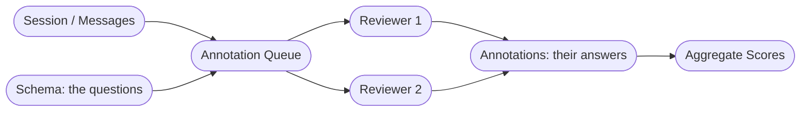

# Annotations

Annotations are a **manual evaluation method**.
Domain experts review chatbot sessions in an annotation queue and record scores, labels and comments against a schema you define.

Use annotations when automated checks can't judge quality reliably, such as tone, correctness in your domain, or policy compliance.
The human judgments give you ground truth for [evaluations](../evaluations/index.md).
You can turn reviewed sessions into an [evaluation dataset](../evaluations/dataset.md), or check how closely an [LLM judge](../evaluations/evaluators.md#llm-evaluator) agrees with your reviewers.

## Use Cases

- **Quality assurance**: have reviewers rate conversation quality on a defined scale
- **Content moderation**: flag problematic sessions and categorize issues
- **Chatbot evaluation**: collect human judgments alongside automated [evaluations](../evaluations/index.md)
- **Dataset labeling**: annotate sessions for downstream model training or fine-tuning
- **Inter-rater agreement**: configure multiple reviews per item to measure how closely reviewers agree

## Overview

Reviewers work through a **queue**, a list of sessions to review.
Every reviewer answers the same set of questions, called the **schema**, for each session.

For example, a team wants to know how well its support chatbot handles billing questions.
It adds 50 billing sessions to a queue.
The schema asks reviewers to rate helpfulness from 1 to 5 and to pick a tone from a list.
Two reviewers annotate each session, and the team reads the average helpfulness score once they finish.

### Key Components

**[Annotation Queue](queues.md)**
: A list of sessions to review, the questions to answer, and the people who answer them.
  The queue also tracks its review progress.

**Annotation Items**
: The sessions or messages in a queue.
  Each item has a status that shows its progress: **Pending**, **In Progress**, **Awaiting resolution** (multi-reviewer queues only), then **Completed**.
  A reviewer can also mark an item **Flagged** for follow-up.
  See [Item Status Lifecycle](annotating.md#item-status-lifecycle).

**[Annotation Schema](queues.md#annotation-schema)**
: The questions every reviewer answers for every item, defined once per queue.
  Because all reviewers answer the same questions, their answers can be compared, summarised in aggregate scores and exported.
  The schema's structure is fixed once reviews begin, so earlier answers stay valid.

**Annotation**
: One reviewer's answers for one item.
  A reviewer annotates each item once and can edit their annotation afterwards.

## Roles

| Role | Capabilities |
|------|-------------|
| Team Admin / Member (with queue permissions) | Create, edit and delete queues, add and remove items, export results, manage assignees, view aggregates |
| **Annotation Reviewer** | View and annotate queues they are assigned to only, including viewing the chat sessions attached to each queue item. Can flag and unflag items, mark annotations authoritative and view aggregates. Cannot manage queues, export, or access other app areas. |

!!! note "Annotation Reviewer role"
    The **Annotation Reviewer** role is designed for external annotators or team members who should only have access to their assigned annotation work.
    They won't see other parts of the application.

## Getting Started

1. [Create an annotation queue](../../how-to/annotations/create-a-queue.md) with a schema and assignees
2. [Add sessions](../../how-to/annotations/create-a-queue.md#add-items-to-the-queue) to the queue
3. Assignees [work through items](../../how-to/annotations/annotate-items.md) and submit annotations
4. If the queue needs several reviews per item, reviewers [resolve conflicts](annotating.md#resolving-multi-reviewer-conflicts) by marking one annotation authoritative
5. [Review progress](queues.md#monitoring-progress), [read the aggregate scores](queues.md#aggregate-scores) and [export results](../../how-to/annotations/export-annotations.md)
6. [Manage the queue](../../how-to/annotations/manage-a-queue.md) as work goes on: unflag items, remove items, or delete the queue when you're done
