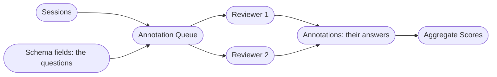

# Annotations

Automated checks can tell you whether a chatbot's reply contains the right facts.
They can't reliably tell you whether a clinician would trust the advice, or whether a reply follows your safeguarding policy.
For that, people who know the subject need to read the conversations and record their judgment.

**Annotations** are how you collect that judgment in Open Chat Studio (OCS).
You choose the conversations to review, write the questions reviewers answer about each one, and assign the reviewers.
OCS tracks progress, summarises the answers, and lets you export them.
Other AI tools call this *human evaluation* or *data labeling*, and the results are often used as *ground truth*.

## Use Cases

- **Quality assurance**: have reviewers rate conversations on a defined scale, alongside automated [evaluations](../evaluations/index.md)
- **Content moderation**: categorise problems in conversations using a list of answers
- **Dataset labeling**: annotate conversations to use for training or fine-tuning a model
- **Inter-rater agreement**: collect several independent reviews per conversation, then export them to measure how closely reviewers agree

## How It Works

In OCS, each conversation between a participant and your chatbot is a **session**.
You collect the sessions to review in an **annotation queue**.
For each queue, you write the questions reviewers answer, such as "How helpful was the chatbot, from 1 to 5?"
Each question is a field, and you add them under **Schema Fields** when you create the queue.
Every reviewer answers the same fields for every session, so their answers can be compared and summarised.

For example, a team wants to know how well its support chatbot handles billing questions.
It adds 50 billing sessions to a queue.
The queue's fields ask reviewers to rate helpfulness from 1 to 5 and to pick a tone from a list.
Two reviewers answer the questions for each session, and the team reads the average helpfulness score once they finish.

## Key Terms

This table lists OCS terms and maps these to the terminology other AI evaluation tools commonly use for the same thing.

| OCS term | What it is | Also called |
|----------|------------|-------------|
| **Session** | One conversation between a participant and your chatbot. | Conversation, sample, record |
| **[Annotation queue](queues.md)** | A list of sessions to review, the questions to answer, and the people who answer them. The queue also tracks its review progress. | Labeling project |
| **Item** | A session once it is in a queue. The queue's **Items** table lists it, and its status shows its review progress. See [Item Status Lifecycle](annotating.md#item-status-lifecycle). | Task, example |
| **[Schema fields](queues.md#schema-fields)** | The questions reviewers answer, such as a rating from 1 to 5, a choice from a list, or a free-text comment. | Rubric, labeling schema, score configuration |
| **Annotation** | One reviewer's answers for one session. A reviewer annotates each session once and can edit their annotation afterwards. | Human label, human feedback, human score |
| **Num reviews required** | How many reviewers annotate each session independently. | Annotator overlap, annotators per item |
| **[Authoritative annotation](annotating.md#resolving-multi-reviewer-conflicts)** | The annotation chosen as the answer for a session when several reviewers disagree. | Gold label, adjudicated label, consensus label |
| **[Aggregate scores](queues.md#aggregate-scores)** | A summary of the answers to each field across the whole queue, such as the mean or the most common answer. | Summary statistics |

## Reviewers

The people who annotate a queue are its reviewers.
The queue page calls them **assignees** (**Manage Assignees**).

## Getting Started

1. [Create an annotation queue](../../how-to/annotations/create-a-queue.md) with schema fields and reviewers
2. [Add sessions](../../how-to/annotations/create-a-queue.md#add-sessions-to-the-queue) to the queue
3. Reviewers [work through the sessions](../../how-to/annotations/annotate-items.md) and submit annotations
4. If the queue needs several reviews per session, reviewers [resolve conflicts](annotating.md#resolving-multi-reviewer-conflicts) by marking one annotation authoritative
5. [Review progress](queues.md#monitoring-progress), [read the aggregate scores](queues.md#aggregate-scores) and [export results](../../how-to/annotations/export-annotations.md)
6. [Manage the queue](../../how-to/annotations/manage-a-queue.md) as work goes on: unflag items, remove sessions, or delete the queue when you're done
