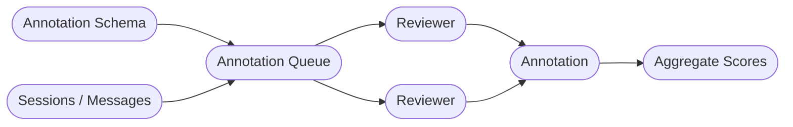

# Annotations

Annotations are a **manual evaluation method**. Domain experts review chatbot sessions and messages in an annotation queue and record scores, labels and comments against a schema you define.

Use annotations when automated checks can't judge quality reliably, such as tone, correctness in your domain, or policy compliance. The human judgments give you ground truth for [evaluations](../evaluations/index.md): you can turn reviewed sessions into an [evaluation dataset](../evaluations/dataset.md), or check how closely an [LLM judge](../evaluations/evaluators.md#llm-evaluator) agrees with your reviewers.

## Overview

The annotations system is built around **queues** — ordered lists of items that reviewers work through one at a time. Each queue defines a custom set of fields (the schema) that reviewers fill in for every item.

### Key Components

**[Annotation Queue](queues.md)**
: The central object. Contains items to be reviewed, defines the annotation schema, manages assignees, and tracks progress.

**Annotation Schema**
: The set of fields reviewers fill in. Defined per queue. Supports integer, float, string, and choice (enum) field types.

**Annotation Items**
: Individual sessions or messages added to a queue. Each item moves through a lifecycle: Pending → In Progress → Completed. On queues that need more than one review, items pass through Awaiting resolution before Completed. Reviewers can flag an item at any point before it completes. See [Item Status Lifecycle](annotating.md#item-status-lifecycle).

**Annotations**
: A single reviewer's submitted responses for one item. Each reviewer can annotate each item only once, but can edit their own annotation afterwards. When reviewers disagree, one annotation is marked **authoritative** and used for aggregate scores.

## Use Cases

- **Quality assurance** — have reviewers rate conversation quality on a defined scale
- **Content moderation** — flag problematic sessions and categorize issues
- **Chatbot evaluation** — collect human judgments alongside automated [evaluations](../evaluations/index.md), for example to check an LLM judge against reviewer scores
- **Dataset labeling** — annotate sessions for downstream model training or fine-tuning, or [import them into an evaluation dataset](../../how-to/evaluations/create-a-dataset.md#import-from-an-annotation-queue)
- **Inter-rater agreement** — configure multiple reviews per item to measure how closely reviewers agree

## Roles

| Role | Capabilities |
|------|-------------|
| Team Admin / Member (with queue permissions) | Create and manage queues, add sessions, export results, manage assignees, view aggregates |
| **Annotation Reviewer** | View and annotate queues they are assigned to only, including viewing the chat sessions attached to each queue item. Cannot manage queues, export, or access other app areas. |

!!! note "Annotation Reviewer role"
    The **Annotation Reviewer** role is designed for external annotators or team members who should only have access to their assigned annotation work — they won't see other parts of the application.

## Getting Started

1. [Create an annotation queue](../../how-to/annotations/create-a-queue.md) with a schema and assignees
2. [Add sessions](../../how-to/annotations/create-a-queue.md#add-items-to-the-queue) to the queue
3. Assignees [work through items](../../how-to/annotations/annotate-items.md) and submit annotations
4. If the queue needs several reviews per item, reviewers [resolve conflicts](annotating.md#resolving-multi-reviewer-conflicts) by marking one annotation authoritative
5. Review progress and [export results](queues.md#exporting-results)
