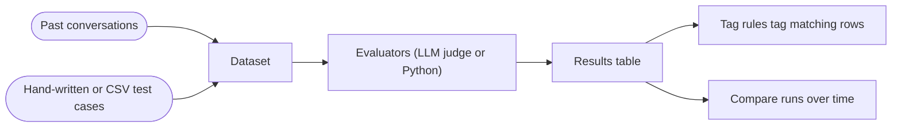

# Evaluations

Building a chatbot is the easy part. Knowing whether it works well is harder.

**Evaluations** let you check this systematically. You run your chatbot against a set of sample conversations and score the results against criteria you define, such as accuracy, tone, or whether it stayed on topic.

Running evaluations regularly gives you an early warning when a change to a prompt, model or pipeline makes responses worse, and proof when a change makes them better. You no longer need to spot-check conversations by hand.

- **[Dataset](./dataset.md)**: the conversations or test cases to score.
- **[Evaluators](./evaluators.md)**: score each row, using an LLM prompt or Python code. Several evaluators can run on the same dataset.
- **[Tag rules](./tag_rules.md)**: tag rows whose scores meet a condition, such as a low rating, so you can find them quickly.

## Example

Suppose you run a health clinic's appointment chatbot and want to switch it to a cheaper model, but you are not sure the answers will stay as good. You build a **dataset** from 50 real past conversations, including some that went badly, and create an **evaluator** that rates each response for helpfulness from 1 to 5.

You run the evaluation with the current model and note the average score, then change the model and run it again. If the average drops, you know the change has a cost before any participant sees it. A **tag rule** can tag every response that scored 2 or lower, so you can open those conversations and see what went wrong.

## Next steps

- [Create a Dataset](../../how-to/evaluations/create-a-dataset.md) — build your first dataset by cloning sessions, importing from an [annotation queue](../annotations/queues.md), or uploading a CSV.
- [Run an Evaluation](../../how-to/evaluations/run-an-evaluation.md) — create an evaluation, preview and run it, and read the results.
