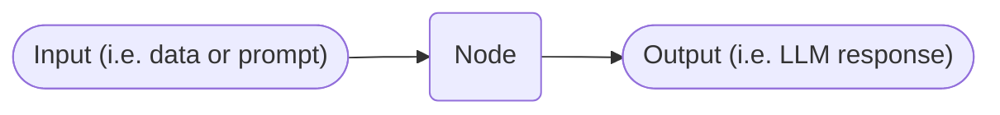

# Node Types

A node is a discrete processing step in a [pipeline](index.md) that accepts a participant's input and produces an output to downstream nodes. Each node performs a specific task, such as calling a [large language model (LLM)](../llm.md), running Python code, or routing based on logic.
It processes data that flows through the pipeline.

!!! note Examples

    1. See a [simple example](./index.md#a-simple-example) of a pipeline with one node.
    2. See [chatbot workflow cookbook](../../how-to/workflow_cookbook.md) for examples of pipelines using different combinations of these node types.

## Node Warnings and Errors

The pipeline editor highlights nodes that need your attention:

- A **red border** means the node has a configuration **error**. The pipeline cannot run until you fix it.
- An **amber border**, together with a warning triangle in the node's header, means the node has a **warning**. Warnings are advisory — the pipeline still saves, runs, accepts a test message, and can be [versioned](../versioning.md).

If a node has both an error and a warning, the red border takes precedence because the error is more urgent.

A node carries a warning when:

- Its **node type** has been deprecated and will be removed in a future release.
- Its **LLM model** has been [deprecated](../team/llm_providers.md#model-lifecycle-and-deprecation). The triangle names the deprecated model and the model to switch to.
  The **LLM Model** field in the node's settings shows the same notice.

A node that is affected by both shows a single triangle carrying both messages.

## LLM Node

A conversational node using AI models. You can configure:

- A [prompt](../llm.md#prompt) for instructions on how to respond
- [Prompt variables](../prompt_variables.md) to insert dynamic content
- A [history setting](history.md) for conversation memory
- [Temperature and effort parameters](../../how-to/adjust_llm_node_model_parameters.md) to shape output style and depth
- [Tools](../tools/index.md) for additional actions
- [Collections](../collections/index.md) for indexed collections to ground responses in your documents (RAG), or media collections to send files to participants.
- [Custom Actions](../llm_custom_action.md) to connect to external systems and retrieve information or complete tasks

See [Configure an LLM Node](../../tutorials/configure_llm_node.md) for a step-by-step tutorial on setting one up.

## Routing Nodes

Routers are used to reduce cost, improve accuracy, and keep pipeline workflows flexible. A router will receive input, analyze it, choose the next workflow step, and pass the request to the downstream node.
See the [Router Node](./router_nodes.md) page for full details.

## Render a Template Node

The Render a Template node lets you shape the text flowing through a pipeline before it reaches the next step. You write a template that mixes fixed text with placeholders.
At runtime, the node fills in the placeholders using information about the current message, the participant, and the pipeline state.

Use this node to reformat a previous node's output, build a prompt for a downstream LLM node, or compose a personalized message.

See the [Render a Template and Send an Email Node](../../tech-hub/template_and_email_nodes.md#render-a-template-node) reference for the full variable list and template syntax.

## Send an Email Node

The Send an Email node sends an email as part of a pipeline run. The node acts as a passthrough: its output is identical to its input.
Inserting it into a pipeline does not change what the next node receives.

See the [Send an Email How-to Guide](../../how-to/send_email_node.md) for steps and example use cases.

See the [Render a Template and Send an Email Node](../../tech-hub/template_and_email_nodes.md#send-an-email-node) reference for recipient field syntax, template variables, and prompt examples.

## Extract Structured Data Node

Uses an LLM to extract structured data from the input.
You define a JSON schema, which describes the fields to extract and their types. Unlike most other nodes, its output **replaces** the input: downstream nodes receive the extracted data (as JSON) rather than the original conversation text.

Sometimes the model returns no structured data for part of the input.
This happens if it refuses, the provider blocks the reply, or it never calls the required tool.
The node skips that part instead of failing the conversation turn.
If nothing at all could be extracted, the node outputs an empty JSON object (`{}`). This is rare in practice.

## Update Participant Data Node

Uses an LLM to extract structured data the same way as the Extract Structured Data node. Instead of passing the result downstream, it saves it as [participant data](../../concepts/participant_data.md). This node is a passthrough — its output is identical to its input. It can be inserted into a pipeline without changing what the next node receives, and is commonly used with [events](../events.md).

It handles a missing response the same way.
The node skips any part of the input with no structured data.
If nothing could be extracted, participant data is left unchanged.

## Python Node

Execute custom Python code for logic, data processing, or external API calls.

**Key capabilities:**

- **[Utility functions](../../tech-hub/python_node.md#utility-functions)** — read and write [participant data](../../concepts/participant_data.md), [temporary state](../../tech-hub/python_node.md#temporary-state) (per pipeline run), and [session state](../../tech-hub/python_node.md#session-state) (per participant session).
- **[Attachments](../../tech-hub/python_node.md#attachments)** — access files uploaded by the participant and read their contents (text, PDF, DOCX, XLSX, and others — see [supported file types](../../tech-hub/python_node.md#supported-file-types)).
- **[HTTP client](../../tech-hub/external-api-calls/http_client.md)** — make secure HTTP requests to external APIs using the built-in `http` global.
- **[Debugging](../../tech-hub/python_node.md#debugging-with-print)** — use `print()` to capture diagnostic output, visible in the trace detail view.

See the [Python Node](../../tech-hub/python_node.md) page for full documentation.

## Removed Nodes

When a node type is retired from Open Chat Studio, pipelines that contain it still open in the editor.
The node renders as a **Removed Node**, with a badge and a message naming the node type to use instead.
The pipeline no longer builds, so its chatbot cannot run until you replace the removed node with a supported one.

The assistant node is in this state.
See [OpenAI Assistants (Removed)](../assistants.md) for background and the [migration guide](../../how-to/assistants_migration.md) for how to replace one.

## See also

- [Router Nodes](router_nodes.md)
- [Conversation History](history.md)
- [Parallel Pipelines](parallel.md)
- [Workflow Cookbook](../../how-to/workflow_cookbook.md)
