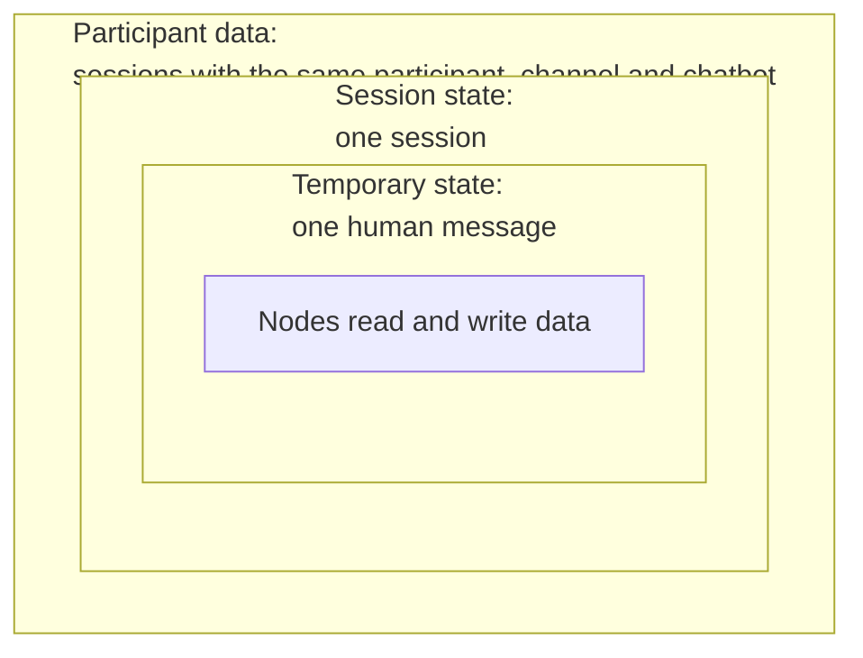

# Pipeline State

**State** is data that the nodes in a [pipeline](index.md) read and write so they can share information.
Read this page to decide where to keep each piece of data.

Examples are a symptom the participant reported, how urgent a message is, or the language they speak.

## Why Pipelines Need State

A pipeline is a series of separate [nodes](nodes.md).
Each node's input is the output of the node before it.
That is not enough for many chatbots.

- A [router](router_nodes.md) may need to know what an earlier node decided.
- A later node may need to know what the participant said earlier.
- A prompt may need information that no node passed along.

## Where to Keep Data

OCS has three places to keep data.
They differ in how long the data lasts.

- **[Session state](#session-state)** lasts for one [session](../sessions.md).
  Use it to remember information across all the messages of a single conversation.
- **[Temporary state](#temporary-state)** lasts for one pipeline run, which processes one human message.
  Use it to pass data from one node to a later node while the current human message is processed.
- **[Participant data](../participant_data.md)** lasts across sessions with the same participant, channel and chatbot.
  Use it for facts that should survive a new session, such as language or name.

Each place lasts longer than the one inside it:

## Example: a Clinic Check-In Chatbot

A chatbot checks in with patients after a clinic visit.
It uses all three places:

- **Participant data** holds the patient's preferred language.
- **Session state** holds the symptoms reported so far in this check-in.
- **Temporary state** holds the urgency of the current human message, either "routine" or "urgent".

The data changes like this:

1. In the first human message, the patient reports a symptom.
   A Python node rates it "urgent" and stores that in temporary state.
   A Static Router reads the urgency and sends the message to the referral branch.
   The Python node also adds the symptom to session state.
2. After the AI message is sent, the temporary state is discarded.
   The reported symptom stays.
3. In the second human message, temporary state holds only the new message's data.
   The earlier urgency value is gone, so a node must rate this message again.
   The earlier symptom is still in session state, so the final summary can include both.
4. A month later the patient starts a new check-in, which is a new session, for example after a session reset.
   The symptom list starts empty, but the preferred language is still there.

## Session State

A new session starts with empty session state, unless you supply it.
Session state is not shared between sessions.

You can supply session state when you start a session through the API, and when you [create evaluation test cases](../../how-to/evaluations/create-a-dataset.md).
For the API parameter, see [Python Node State and Attachments](../../tech-hub/python_node_state_and_attachments.md#session-state).

## Temporary State

OCS fills temporary state with the human message, the outputs of earlier nodes, and any attachments the participant sent.
Nothing carries over to the next human message.

## Where You Can Use State

- **[LLM node tools](../tools/index.md#session)** read and write session state, if the session state tools are enabled.
- **[Prompts](../prompt_variables.md)** can insert both session state and temporary state.
- **[Static Router](router_nodes.md#static-router-node)** reads either one to choose a route.
- **[Render Template and Send Email nodes](../../tech-hub/template_and_email_nodes.md)** can insert both into the text they produce.

## See also

- [Python Node](../../tech-hub/python_node.md) — write code that reads and writes state.
- [Python Node State and Attachments](../../tech-hub/python_node_state_and_attachments.md) — default keys, reserved keys, and the functions that read and write state in code.
- [Configure a Static Router](../../how-to/routers/static_router.md) — route on state data.
- [Prompt Variables](../prompt_variables.md) — insert state into a prompt.
