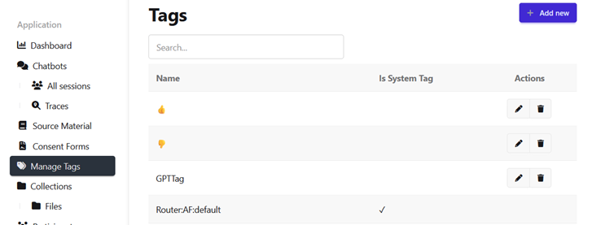
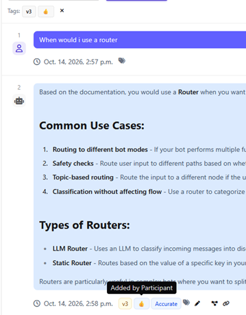

# Tags

Tags are labels applied to chats and messages to categorize and organize interactions.
For instance, tags can mark messages that require follow-up or segment participants based on their interactions.

Tags can be created using the **Manage Tags** section.

## Types Of Tags

There are 3 types of tags.

### System tags
These are tags generated by the system, such as those used in [multi-prompt architectures](../how-to/workflow_cookbook.md#split-a-chatbot-into-multiple-smaller-chatbots) to differentiate between parent and child chatbots.

### Session tags
These tags are manually added to [sessions](sessions.md).

### Message tags
These tags are added to specific messages within a participant session, either manually or by pipeline nodes.
Nodes use the **Message Tag** field, the router **Tag Output Message** setting, or the Python node `add_message_tag` function.

## Tag name length

Tag names are limited to 100 characters.

The **Message Tag** field on pipeline nodes accepts up to 100 characters.
If the tag is longer, the field shows a validation error and the chatbot does not reply until you shorten the tag.

Longer tags added by a router node (**Tag Output Message**) or the Python node `add_message_tag` and `add_session_tag` functions are cut to 100 characters when saved.

## See also

- [Chat Sessions](sessions.md)
- [Python Node utility functions](../tech-hub/python_node.md#utility-functions)
