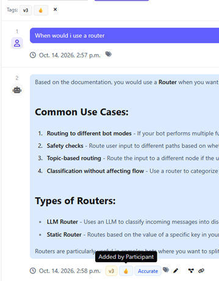

# Tags

Tags are labels you attach to messages and sessions.
They help you find the conversations and replies that matter without reading every chat.

## What you can do with tags

- **Review the replies on one topic.**
  Set a [node](pipelines/nodes.md) to tag the replies that refer participants to the clinic with `clinic-referral`, then read them together to check the advice is safe and clear.
  See [Tag a Node's Output Messages](../how-to/tag_node_output.md).
- **See which path a router chose.**
  Tag each route of a [router](pipelines/router_nodes.md), then find the messages that fell back to the default route.
  See [Tag a Router's Route](../how-to/routers/tag_router_routes.md).
- **Flag a message or conversation yourself.**
  Mark a complaint, or a session that needs a person to follow up.
  See [Create and Manage Tags](../how-to/manage_tags.md#tag-a-message-or-session-by-hand).
- **Let an evaluation flag problems for you.**
  A tag rule can add a tag such as `goal-not-met` to the sessions that score badly, so you can skip the rest.
  See [Tag Rules](evaluations/tag_rules.md).

After you tag, use the **Tags** filter on the sessions list to see only the conversations you want.
See [Tags on the Sessions List](sessions.md#tags-on-the-sessions-list).

## Message tags and session tags

A message tag labels one message, either a participant's message or the chatbot's reply.
A session tag labels a whole conversation, such as its outcome or topic.
Use a message tag when you want to find a specific message, and a session tag when you want to describe the conversation.

## Tags in a session

Open a session to see its tags and the tags on each message.
Session tags appear in the **Tags** tile of the session summary at the top.
Message tags appear beside each message's timestamp.
Hover over a tag to see who added it, for example "Added by Participant".

## System tags

OCS adds some tags itself, called system tags.
For example, each chatbot reply carries a version tag such as `v3`, or `v3-unreleased` for an unpublished version.
Router [route tags](../how-to/routers/tag_router_routes.md) are system tags too.
System tags appear in a different colour, and you cannot select, edit or delete them yourself.

## See also

- [Chat Sessions](sessions.md)
- [Create and Manage Tags](../how-to/manage_tags.md)
