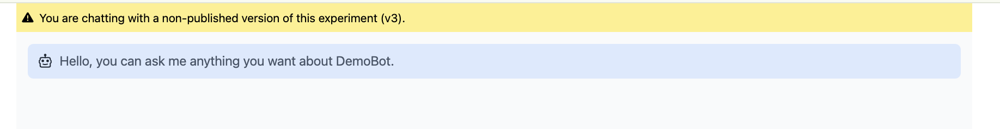

# Versioning

Versioning keeps your live chatbot stable while you make changes.
You can edit and test your chatbot without affecting your participants.
For more details, see the tutorial on [creating and publishing versions](../tutorials/versioning_steps.md).

Versioning tracks the history of your chatbot's configuration.
You can review what changed and roll back to a previous version if needed.

## Terminology

- **Unreleased Version**.
  This is the version of the chatbot you are currently editing.
  It is a draft that has not been versioned or published.

- **Published Version**.
  This is the version that participants interact with, through the web, WhatsApp, or any other [channel](channels.md) you have set up, including the public link.

## What is a Chatbot Version?

Once a version is created, it cannot be edited or modified.
This ensures that the participants' experience remains stable even if chatbot editors are changing the unreleased version.

### What is frozen — and what is live

Most of a published version's configuration is frozen at publish time.

One exception is **collection content**, which behaves as a live shared resource — updates reach the published chatbot without a republish.
See [Collections and published chatbots](collections/index.md#collections-and-published-chatbots) for what is live and what is frozen, and how this affects drift detection.

## Chatting to the unreleased version
To chat with the unreleased draft chatbot for testing, go to the chatbot home page.
Click the speech bubble icon in the top-right corner.
In the dropdown, select **Unreleased Version** instead of **Published Version** to open a web chat.

When chatting with an unpublished version, a banner will appear indicating that it is not the published version and showing the version number.

Only chatbot editors can chat with the unreleased version because it is not available through [channels](channels.md).

!!! note "Behavior before versioning"
    Previously, all channels always used the unreleased version.

## Changing the Published Version

The published version can be selected from any of the Chatbot versions, enabling rollback to a previous version.
Only one version can be the published version at a time.

To publish a version, follow the tutorial on [creating and publishing versions](../tutorials/versioning_steps.md).

## Reverting to a Previous Version

Reverting replaces your current working (unreleased) state with a copy of an older version's configuration.
The older version itself is not modified — a fresh copy becomes your new working state, ready to edit or publish.

### The revert confirmation modal

When you click **Revert** on a version, a confirmation modal opens instead of a plain confirm dialog.
The modal lists what will change, field by field and node by node, so you can check before committing.
Added fields are highlighted and removed fields are marked, so you can compare your current working state with the target version.

### Warning for unreleased changes

If your current working version has unreleased changes (changes that do not belong to any saved version), a warning appears in the modal.
The warning tells you that reverting will overwrite those unreleased changes permanently.
If you see this warning, review the changes carefully before confirming.

!!! warning "Unreleased changes are permanently lost on revert"
    Once you confirm a revert, any edits in the unreleased working state that are not part of a saved version cannot be recovered.
    Create a new version first if you want to preserve those changes.

## See also

- [Creating and publishing versions](../tutorials/versioning_steps.md)
- [Collections and published chatbots](collections/index.md#collections-and-published-chatbots)
- [Consent Forms](consent.md)
- [Channels](channels.md)
