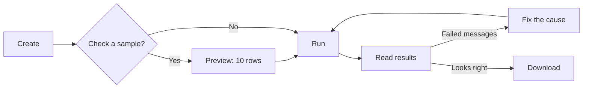

# Run an Evaluation

This guide shows you how to create an evaluation, run it, and read the results. An evaluation combines a [dataset](../../concepts/evaluations/dataset.md) with one or more [evaluators](../../concepts/evaluations/evaluators.md). Each run scores the dataset and records the results.

## Prerequisites

- A dataset with at least one row. See [Create a Dataset](create-a-dataset.md).
- At least one evaluator whose **[Evaluation mode](../../concepts/evaluations/evaluators.md)** matches the dataset's **[Evaluation level](../../concepts/evaluations/dataset.md#evaluation-levels)**.

## Create an evaluation

Under **Evaluations**, click **Add new** and choose:

- The **Dataset** and the **Evaluators** to run. Evaluators whose mode does not match the dataset's level are hidden from the list. Until you select a dataset, only Message-mode evaluators are shown.
- Optional: **Run generation step before evaluation**, with a **Chatbot** and **Chatbot version**, to score a response your chatbot generates instead of the one stored in the dataset. Generation is available for message-level datasets only.
- Optional: **Auto-run when new rows are auto-populated**. See [Set Up a Real-Time LLM Judge](realtime_llm_judge.md) for how this works and what it costs.

Use **Edit** on the evaluation to change these later.

## Preview the evaluation

A preview scores a sample of 10 rows from the dataset. Use it to check your evaluator prompts and output fields before you pay for a full run.

1. Open the evaluation from the **Evaluations** list.
2. Click **Preview**.
3. Review the results. If they look right, click **Run evaluation (N messages)** on the preview page to do the full run, where N is the number of rows in the dataset.

Previews are deleted after one day.

## Run the evaluation

1. Open the evaluation from the **Evaluations** list.
2. Click **Run Evaluation**.

The run page opens and shows the run status: **Pending**, **Processing**, **Completed** or **Failed**.

A manual run scores the whole dataset. The runs list also shows [delta runs](../../tech-hub/evaluations/auto_population.md#automatic-delta-evaluation-runs), which start automatically and score only new rows.

## Read the results

When a run completes, the run page shows:

- **Results**: the number of scored rows.
- **Failed messages**: shown only when some rows failed. See [Failed messages](#failed-messages).
- **Cost** and token count, and **Duration**. Cost shows **Not recorded** when no usage was recorded for the run.
- Aggregate statistics for each evaluator output field.

The results table has one row per message or session, with a column for each evaluator output field. If you defined tag rules, the **Applied Tags** column shows the tags each row received. Use the filter pills above the table to show only rows with a particular output value. Click a row to see its details.

The **Evaluation Runs** page also shows **Trends** across runs and your **Spend** on the evaluation for the last 30 days and for all time.

## Download results

Click **Download results** on a run page to download that run, or **Download Latest Results** on the runs page for the evaluation's latest results. Large files are prepared in the background and a download link appears when ready.

## Correct results

To update results with values from a CSV file, for example after a human reviews them, open a completed run and click **Edit results**. Use **Download Template** to get a file in the expected format, edit it, and upload it. Map each CSV column to an evaluator output, or choose **Skip this column**, then click **Upload Results**. Existing results are updated, new rows are added, and the run's aggregates are recalculated.

## Failed messages

A message fails when the chatbot cannot generate a response or an evaluator cannot return a result. Examples are a provider that has no credit left, a rate limit, or a model that returns no structured output.

- Failed rows carry a badge in the results table. The **Errors** filter pill shows only those rows, and opening a row shows the reason.
- Failed results are left out of the aggregates, tags, trends and scores.
- When more than 5% of a run's messages fail, the run page shows a warning that groups the failures by cause and says what to do about each.
- Your team gets a [notification](../../concepts/notifications.md) when a run completes with more than 5% failed messages, and when a run fails outright.
- The downloaded CSV has a `generation_error` column for rows where generation failed.

Fix the cause, then run the evaluation again.

## Clear run history or delete the evaluation

- **Clear all** on the runs page deletes every run and result, and removes the tags those runs applied through [tag rules](../../concepts/evaluations/tag_rules.md). Tags added by hand are kept.
- **Delete** removes the evaluation with all of its runs and results.

!!! warning "Both actions are permanent"
    [Download the results](#download-results) you need first. Each button appears only for users with the matching delete permission.

Neither action works while a run is pending or processing. Wait for the run to finish, then try again.

## Common issues

- **An evaluator is missing when creating the evaluation.** Its **Evaluation mode** does not match the dataset's [evaluation level](../../concepts/evaluations/dataset.md#evaluation-levels), or it is [archived](../../concepts/evaluations/evaluators.md#archiving-evaluators).
- **Run Evaluation shows an error.** The evaluation has no evaluators, or all of them are archived.
