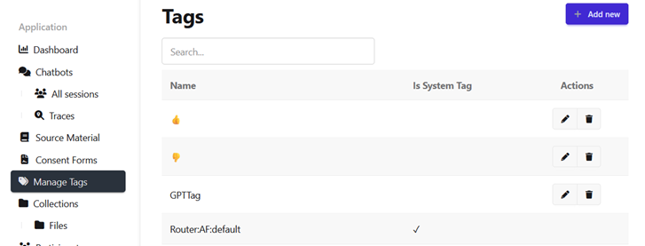

# Create and Manage Tags

This guide shows you how to create tags, rename or delete them, and add them to a message or session by hand.
For background on what tags are for, see [Tags](../concepts/tags.md).

## Prerequisites

- Permission to add tags, if you want to create them.
  The **Manage Tags** link appears in the team sidebar only if you have it.
- A [session](../concepts/sessions.md) with messages, if you want to tag by hand.

## Create a tag

1. Select **Manage Tags** in the team sidebar.
2. Click **Add new**.
3. Enter a name of up to 100 characters.
4. Click **Create**.

Tag names must be unique within your team.

## Rename or delete a tag

On the **Manage Tags** page, use the edit or delete action in the tag's row.
System tags have neither action, because OCS manages them.

Deleting a tag removes it from every message and session that carries it.
OCS blocks the deletion if an evaluator's [tag rule](../concepts/evaluations/tag_rules.md) uses the tag.
Remove the tag from the rule first.

## Tag a message or session by hand

1. Open a session from **All Sessions**.
2. To tag a message, hover over it and click the pencil icon (:fontawesome-solid-pencil:) beside its tags.
   To tag the whole session, click **Add tag** in the **Tags** tile of the session summary.
3. Select one or more tags from the list.
   To create a new tag here, type its name.
   Without permission to add tags, you can only select existing tags.
4. Click outside the list to close it.
   Each tag is saved as soon as you select it.

The tags appear on the message or in the session summary.
See [Tags in a session](../concepts/tags.md#tags-in-a-session).

## See also

- [Tags](../concepts/tags.md)
- [Tag a Node's Output Messages](tag_node_output.md)
- [Chat Sessions](../concepts/sessions.md#tags-on-the-sessions-list)
