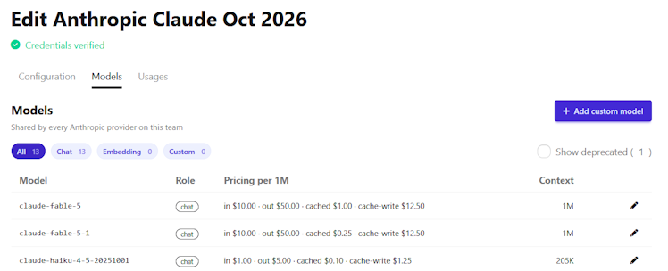

# Review Models and Manage Pricing

Use the **Models** tab on an [LLM provider's edit page](../concepts/team/llm_providers.md#provider-edit-page-tabs) to compare the pricing and context size of the models the provider can run.
Global pricing is the default price OCS sets for each model.
If your team pays different prices, or a model has no pricing, you can set your own.
These prices apply only to your team.

## Prerequisites

- A [configured LLM provider](../tutorials/configure_llm_providers.md) in your team, already saved.
  The **Models** tab appears only once the provider exists.

## Review the models

Review the models to compare pricing and context sizes before you [choose a model](choose_llm_model.md), or to check what your team is charged for.

1. Go to your team's **LLM and Embedding Model Service Providers** settings.
2. Edit the provider, then open the **Models** tab.

- The **Role** column shows whether a model is a chat or an embedding model.
  The filter pills (**All**, **Chat**, **Embedding**, and **Custom**) narrow the list.
- **Pricing per 1M** shows prices in US dollars per 1M [tokens](../concepts/llm.md#tokens).
  Each price the model has is labeled **in**, **out**, **cached**, or **cache-write**.
  A chat model with no pricing shows **No pricing configured**, so [set pricing](#set-or-override-pricing) to add it.
  Embedding models show a dash instead of prices.
  A **manual** badge next to the prices means they were entered by hand, which includes prices your team set with [Set or override pricing](#set-or-override-pricing).
  A row that shows prices but no badge uses the standard global pricing.
  A row showing **No pricing configured** has no prices yet, so it needs [pricing set](#set-or-override-pricing).
- **Context** is the model's [max token limit](../concepts/llm.md#max-token-limit).

## Set or override pricing

Override pricing when your team pays different prices from the global pricing, for example under a discounted contract with Anthropic.
Set pricing when a model shows **No pricing configured**.

1. On the model's row, click the pencil icon (**Override pricing for this team**).
   For a model showing **No pricing configured**, you can also click **Set pricing**.
2. In the dialog, enter at least one of **Input price**, **Output price** and **Cached input price**, in dollars per 1M tokens.
   Leave a field blank to inherit the global rate.
3. Click **Save override**.

The row now shows your prices.
The dialog has no cache-write price, so you can't set it here.

## Revert to global pricing

Revert when you want a model to use the global pricing again instead of your team's own prices.

Click the undo icon (**Revert to global pricing**) on the model's row.
Confirm "Remove the team override and fall back to the global rate?".
The row returns to the global pricing.

The icon appears only when the model has both a team override and global pricing.
A [custom model](#work-with-custom-models) has no global pricing, so it has no revert icon.

## Work with custom models

Custom models behave differently from pre-configured ones in the ways listed below.
A **custom** badge marks a model your team added.
It appears under both the **Chat** and **Custom** filters.
To add one, see [Add a Custom LLM Model](add_custom_llm_model.md).

- A custom model with no pricing shows **No pricing configured**.
  Click **Set pricing** on its row to [add it](#set-or-override-pricing).
- To delete a custom model, click the trash icon on its row and confirm.
  Pre-configured models can't be deleted.

## Find deprecated models

Deprecated models are hidden by default, so a model you expect may seem to be missing from the list.
They stay hidden until you select the **Show deprecated** checkbox.

For why models are deprecated, see [Model Lifecycle and Deprecation](../concepts/team/llm_providers.md#model-lifecycle-and-deprecation).

## Common issues

- **A model has no pencil icon.**
  [Deprecated](#find-deprecated-models) and embedding models can't be given pricing.
- **The prices differ from what my provider charges.**
  The prices shown are rates configured in OCS, not the amounts your provider actually charges.
  To verify your charges, check your provider's billing information.
  If your team pays different rates, [override the pricing](#set-or-override-pricing).
- **Two providers show the same models and prices.**
  Providers of the same type share models and prices.
  The tab says, for example, "Shared by every Anthropic provider on this team", using the provider's type.
  A price you set on one provider applies to all providers of that type.

## See also

- [Choose an LLM Model for Your Chatbot](choose_llm_model.md) — pick a model once you've compared pricing and context sizes
- [Add a Custom LLM Model](add_custom_llm_model.md) — add a model that isn't pre-configured, including naming conventions per provider
- [LLM Service Providers](../concepts/team/llm_providers.md) — what providers and models are, and how model deprecation works
- [Large Language Models (LLMs)](../concepts/llm.md) — tokens and the context window
