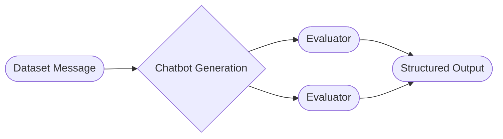

# Evaluations Reference

This section covers how evaluation runs execute, reference detail for datasets and evaluators, custom Python evaluators, and continuous dataset ingestion.

For a non-technical overview of datasets, evaluators, and how evaluation runs work, see [Evaluations](../../concepts/evaluations/index.md).

## Evaluation execution

For the steps to create and start a run, see [Run an Evaluation](../../how-to/evaluations/run-an-evaluation.md).

When an evaluation is run, each message from the dataset is first passed into the defined chatbot (if applicable). The result, with the added generation output, is then passed into each evaluator in parallel. The evaluators output structured data. This data is compiled into a table, whose rows are each message and the columns are the evaluator output.

### Chatbot generation

Messages can also optionally be passed into a [chatbot](../../concepts/chatbots/index.md), whose generation output will be available to the evaluators.

### Session retention

When evaluations are run with chatbot generation enabled, temporary sessions are created to store the generated responses and conversation context. These evaluation sessions are automatically deleted after **30 days**.

!!! warning "Data Retention"
    Session deletion is permanent and cannot be undone. Ensure you export any evaluation results you need to retain before the 30-day retention period expires.

!!! note "Source Sessions Unaffected"
    This automatic deletion only affects sessions created during evaluation runs. Source sessions (the original sessions that datasets may be cloned from) are not affected by this retention policy and remain in the system according to their own lifecycle.

### Failed messages

For what a failed message is and how to find and fix failed rows, see [Run an Evaluation](../../how-to/evaluations/run-an-evaluation.md#failed-messages).

- Failed rows carry a badge in the results table.
- Failed results are left out of the aggregates, tags, trends and scores.
- When more than 5% of a run's messages fail, the run page shows a warning that groups the failures by cause and says what to do about each.
- Your team gets a [notification](../../concepts/notifications.md) when a run completes with more than 5% failed messages, and when a run fails outright.
- The downloaded CSV has a `generation_error` column for rows where generation failed.

## Pages in this section

- **[Dataset Structure](./dataset-structure.md)** — field-level reference for dataset rows, cloning field mappings, history syntax, and CSV format details.
- **[Evaluator Reference](./evaluator-reference.md)** — template variables for LLM evaluator prompts, output validation, and tag reconciliation on rerun.
- **[Python Evaluator](./python_evaluator.md)** — write custom Python code to score messages, for deterministic rules or logic an LLM prompt can't reliably express. See [Evaluators](../../concepts/evaluations/evaluators.md#python-evaluator) for when to choose it over the LLM Evaluator.
- **[Auto-Population Rules](./auto_population.md)** — continuously ingest new sessions into a session-level dataset from a live chatbot, and trigger automatic delta evaluation runs against the new rows.
